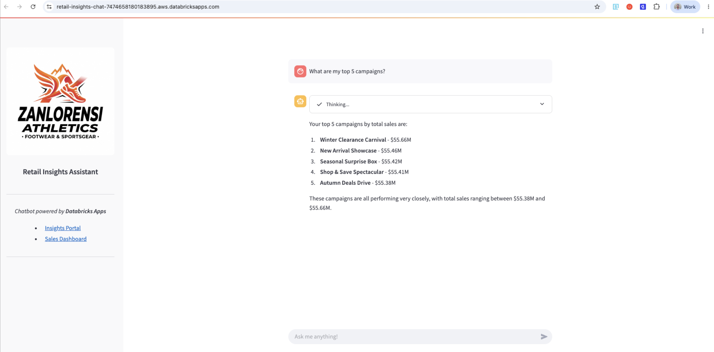

# Apps — Marketing Campaign Insights Custom Chat App

Stage 4 of [Marketing Campaign Analytics](../README.md). Deploys a production
**Custom Chat App** — a Streamlit UI on **Databricks Apps** — that calls the
**Agent Bricks agent** deployed in stage 3.



## Prerequisites

- Stages 1–3 complete — the agent app `agent-bricks-marketing-agent` is deployed and
  `3_agent-bricks/4_GrantAgentAccess` has run.
- Permission to **deploy Databricks Apps**.

## Notebook

### 0_DeployChatApp

Creates the app, grants the app's service principal **`CAN_USE` on the agent app**, deploys
the sibling [`chat_app/`](chat_app/) folder, and prints the app URL. The agent runs its tools
(Genie, `search_contracts`) with its own service principal, so the chat app needs no data grants.

**Parameters:** `APP_NAME`, `AGENT_APP_NAME` (default `agent-bricks-marketing-agent`; must match
`AGENT_APP_NAME` in `chat_app/app.yaml`), `APP_SOURCE_PATH` (blank = sibling `chat_app/` folder)

## How the app talks to the agent

Each browser chat gets one agent `session_id`. Every turn sends only the new user message to
`<agent-url>/api/invocations`, authenticated with the app's service principal (OAuth). The
agent's managed session store keeps the conversation history, so earlier turns are not resent.

## `chat_app/` — the app source

| File | Purpose |
| --- | --- |
| `app.py` | Streamlit custom chat UI with sidebar branding |
| `agent_client.py` | Agent app lookup, OAuth call to `/api/invocations`, final-answer parsing |
| `app.yaml` | App config (`AGENT_APP_NAME`) |
| `requirements.txt` | Dependencies |
| `style.css` | Custom styling |
| `figures/brand_logo.png` | Sidebar logo (runtime asset) |

## Directory structure

```
4_apps/
├── 0_DeployChatApp.ipynb
├── chat_app/
└── README.md
```

Documentation screenshots live at [`../docs/figures/`](../docs/figures/).
