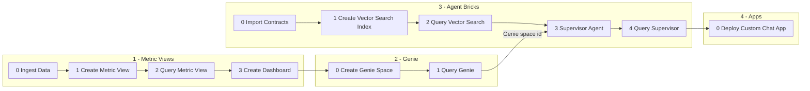

# Marketing Campaign Analytics

An end-to-end Databricks workshop for a fictional retailer, **Zanlorensi Athletics**,
that turns raw sales data and contract documents into a single, governed,
conversational analytics experience.


The finished **Marketing Campaign Insights Assistant** is a **Custom Chat App**
(Streamlit on Databricks Apps) that routes questions to the right specialist agent — contracts (Vector Search
retriever) or sales analytics (Genie) — behind a single conversational interface.

> **Runs on Databricks Free Edition.** Knowledge Assistant isn't available there,
> so the contract-retrieval agent is built with **Vector Search**, attached to the
> Supervisor Agent as a native Vector Search tool.

## Workshop flow


<details>
<summary>Mermaid source (renders on GitHub)</summary>



</details>

## What you'll build

| Stage | Folder | What it delivers |
| --- | --- | --- |
| **1. Metric Views** | [`1_metric-views/`](1_metric-views/) | Marketing campaign star schema + governed **UC Metric View** (`sales_relationships`) + **AI/BI dashboard** |
| **2. Genie** | [`2_genie/`](2_genie/) | **Genie space**, API query validation, and [best practices](2_genie/docs/genie-best-practices.md) |
| **3. Agent Bricks** | [`3_agent-bricks/`](3_agent-bricks/) | **Vector Search** index over contract PDFs (native Vector Search tool) + **Supervisor Agent** routing to Genie |
| **4. Apps** | [`4_apps/`](4_apps/) | Production **Custom Chat App** (Streamlit on Databricks Apps) with automatic permission grants |

```
Marketing Campaign Analytics
├── docs/figures/          Screenshots and visual assets
├── 1_metric-views/        UC Business Semantics + data ingestion + dashboard
├── 2_genie/               Genie space, best practices
├── 3_agent-bricks/        Vector Search retriever + Supervisor Agent
└── 4_apps/                Databricks App deployment
```

## Prerequisites

**This workshop runs on Databricks Free Edition**.

Your workspace needs:

- **Unity Catalog** and **serverless compute**
- **Genie** plus a **SQL warehouse** (dashboard and sales analytics)
- **Vector Search**, **Supervisor Agents**, and an embedding endpoint (`databricks-gte-large-en`)
- **Foundation models** via **Databricks Model Serving** (Genie, embeddings, and the Supervisor all call served models)
- Permission to create catalogs/volumes and to deploy **Databricks Apps** 

## How to run

Run the four stages **in order**. Each stage passes outputs to the next via
notebook widgets.

| Step | Folder | Notebooks | Carry forward |
| --- | --- | --- | --- |
| 1 | [`1_metric-views/`](1_metric-views/) | `0` → `3` | Metric view `sales_relationships` + published dashboard |
| 2 | [`2_genie/`](2_genie/) | `0` → `1` | **Genie Space id** (from notebook `0`) |
| 3 | [`3_agent-bricks/`](3_agent-bricks/) | `0` → `4` | Pass Genie Space id into notebook `3`; note **Supervisor name** |
| 4 | [`4_apps/`](4_apps/) | `0` | Deploys the custom chat app, prints URL |

Every notebook exposes its configuration as **widgets** with documented defaults.
The catalog defaults to **`workspace`** (your workspace's built-in Unity Catalog —
no new catalog to create) and the schema to **`marketing_campaign`**.
Each notebook includes a parameter table explaining what every widget controls.
