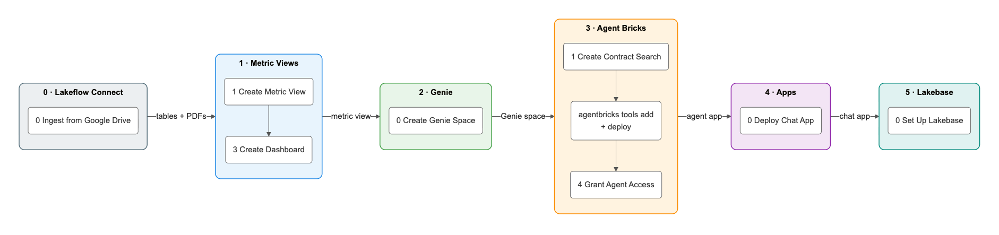
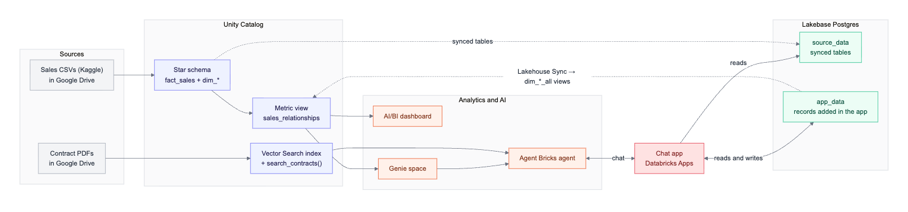
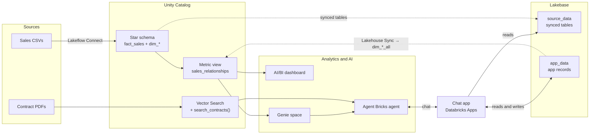

# Marketing Campaign Analytics

**Industry: retail.** Zanlorensi Athletics, a fictional footwear and sports gear retailer, runs 50
marketing campaigns a year with agency partners. Its marketing team can't answer basic questions
fast: *which campaigns pay back their budget, which segments and cities respond, and what do our
agency contracts say about fees and terms?* Answers sit in different BI reports and PDF contracts,
and new campaigns live in spreadsheets that analytics never sees.

This repo is one integrated Databricks build that fixes that: sales data and contracts become a
governed semantic layer, a Genie space, and an agent that answers both kinds of question in a chat
app, where marketers can also add campaigns and customers. Data is public (Kaggle retail star
schema, with names replaced by generated pseudonyms and e-mails moved to `example.com`) or
fictional (four generated contracts); no customer data is used.

The full blueprint (specs for every component, and how to adapt it to your own marketing analytics
project) is in [`docs/SPECS.md`](docs/SPECS.md). The output of a full measured run against the live workspace (every stage, masked) is in
[`docs/RUN_LOG.md`](docs/RUN_LOG.md).
The business deck for the CMO and the marketing analytics lead is [`docs/deck.pdf`](docs/deck.pdf).

## The journey in 6 steps

| # | Step | What it does here | Where |
| --- | --- | --- | --- |
| 1 | **Lakeflow Connect** | Managed Google Drive pipeline lands 7 CSVs as Delta tables and the PDFs in a volume | [`0_lakeflow-connect/`](0_lakeflow-connect/) |
| 2 | **Unity Catalog** | Star schema, metric view `sales_relationships` (one KPI definition) with example queries, AI/BI dashboard, least-privilege grants | [`1_metric-views/`](1_metric-views/) |
| 3 | **GenAI** | `ai_parse_document` + Vector Search over contracts as UC function `search_contracts`; Agent Bricks agent routes between Genie and contracts | [`3_agent-bricks/`](3_agent-bricks/) |
| 4 | **Lakebase** | App-owned Postgres tables for new campaigns/customers; synced tables bring source data in; Lakehouse Sync streams app rows back to UC | [`5_lakebase/`](5_lakebase/) |
| 5 | **Genie** | Space on the metric view with business rules and 8 verified example queries | [`2_genie/`](2_genie/) |
| 6 | **Databricks App** | Streamlit chat app: Assistant (calls the agent) and Add data (reads and writes Lakebase) | [`4_apps/`](4_apps/) |

Mermaid source (renders on GitHub)

## Measured results

From a live run on 2026-11-18; full masked output in [`docs/RUN_LOG.md`](docs/RUN_LOG.md).

| Stage | Result |
| --- | --- |
| Lakeflow Connect | Pipeline update `COMPLETED`: 1,000,000 sales, 100,000 customers, 50 campaigns, 4 contract PDFs landed from Drive |
| Unity Catalog | Metric view returns the top campaigns with sales per budget dollar (3.0s); the chat app's service principal holds no UC grants |
| GenAI | `search_contracts` ranks the right contract first (score 0.62, 2.5s); the agent picked the right tool(s) for 3/3 questions, including one that needs both |
| Lakebase | Insert through the app's code in 1.3s, listed in the app 1.3s later, in Unity Catalog via Lakehouse Sync after 19s (delete: 18s) |
| Genie | 9/10 against SQL ground truth; the miss is an ambiguous question that passes when reworded |
| App | `RUNNING`; reads 51 campaigns from Lakebase in 3.8s |

## Decisions and how AI was used

| Decision | Trade-off accepted |
| --- | --- |
| One metric view feeds the dashboard and Genie, so KPIs can't drift | Joins live in YAML; extending it means learning `MEASURE()` |
| Vector Search + a UC function instead of a Knowledge Assistant: governed like any UC object | We own parsing, chunking and the index refresh |
| Code-first agent (Agent Bricks CLI); tools run as the agent's own service principal | Beta CLI, and every new tool needs a grant |
| Lakebase is the app's only store: synced tables in, app-owned tables out, Lakehouse Sync back to UC. We first read through a SQL warehouse and moved off it after measuring cold starts | Snapshot refresh when sources change; seconds of lag back to UC |

**AI usage.** Built with Claude Code as a pair programmer. I set the problem, scope, architecture
and the Lakebase design; the AI drafted the app UI, `lakebase.py`, the synced-table and grant steps,
the diagrams, the contract PDFs and the measurement script. Every output was checked in the deployed
workspace, in a browser, or against SQL ground truth. The measured runs caught two bugs that were
then fixed: a timestamp-vs-date join in the metric view, and the agent losing its contract tool
after a rebuild.

## Run it

Run the stages in order. Each notebook takes widgets (defaults: catalog `workspace`, schema
`marketing_campaign`) and documents them in a parameter table at the top.

| Step | Folder | Run | Produces |
| --- | --- | --- | --- |
| 0 | `0_lakeflow-connect/` | `0` | Delta tables and contract PDFs from Google Drive |
| 1 | `1_metric-views/` | `1`, then `3` | Metric view (with example queries) and published dashboard |
| 2 | `2_genie/` | `0` | Genie space |
| 3 | `3_agent-bricks/` | `1`, then in `agent/` the two `agentbricks tools add` commands `1` prints and `agentbricks deploy`, then `4` | Contract search tool and the agent app |
| 4 | `4_apps/` | `0` | Chat app |
| 5 | `5_lakebase/` | `0` | Add data page, synced tables, Lakehouse Sync |

**Needs:** Unity Catalog, serverless, a SQL warehouse, Genie, Vector Search, Databricks Apps,
Lakebase, a Google Drive UC connection, and the
[Agent Bricks CLI](https://docs.databricks.com/aws/en/agents/quickstart).
