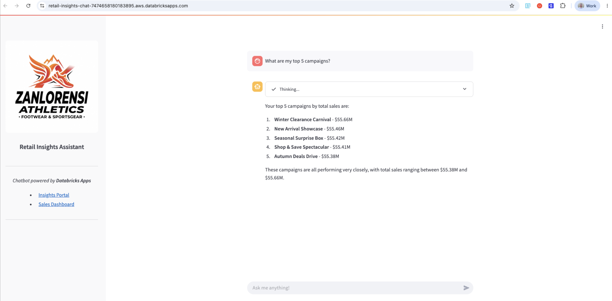
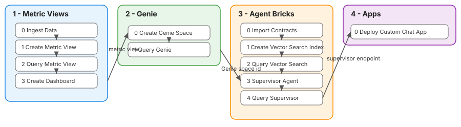

# Marketing Campaign Analytics

An end-to-end Databricks workshop for a fictional retailer, **Zanlorensi Athletics**,
that turns raw sales data and contract documents into a single, governed,
conversational analytics experience.



The finished **Marketing Campaign Insights Assistant** is a **Custom Chat App**
(Streamlit on Databricks Apps) backed by an agent built with the **Agent Bricks CLI**. The agent
routes each question to the right tool — contracts (Vector Search, exposed as a Unity Catalog
function) or sales analytics (Genie) — behind a single conversational interface.

Data can be loaded two ways: from Kaggle and this repo (stages 1 and 3), or from **Google Drive
with Lakeflow Connect** (optional stage 0), which lands the structured CSVs as Delta tables and the
unstructured contract PDFs in a Unity Catalog volume.

> **Free Edition.** Stages 1–2 and the Vector Search part of stage 3 run on Databricks Free
> Edition. Knowledge Assistant isn't available there, so contract retrieval is built with
> **Vector Search**. The Agent Bricks CLI and the Lakeflow Connect Google Drive connector are in
> preview/Beta; check their availability in your workspace.

## Workshop flow

```mermaid
%%{init: {'flowchart': {'padding': 10, 'nodeSpacing': 24, 'rankSpacing': 32}}}%%
flowchart LR
    subgraph S0["0 - Lakeflow Connect (optional)"]
        direction TB
        LC0["0 Ingest from Google Drive"]
    end

    subgraph S1["1 - Metric Views"]
        direction TB
        MV0["0 Ingest Data"] --> MV1["1 Create Metric View"] --> MV2["2 Query Metric View"] --> MV3["3 Create Dashboard"]
    end

    subgraph S2["2 - Genie"]
        direction TB
        G0["0 Create Genie Space"] --> G1["1 Query Genie"]
    end

    subgraph S3["3 - Agent Bricks"]
        direction TB
        AB0["0 Import Contracts"] --> AB1["1 Create Vector Search Index"] --> AB2["2 Query Vector Search"] --> AB3["3 Contract Search Tool"] --> ABD["agentbricks deploy"] --> AB4["4 Grant Agent Access"]
    end

    subgraph S4["4 - Apps"]
        direction TB
        AP0["0 Deploy Custom Chat App"]
    end

    LC0 -.->|sales tables| MV0
    LC0 -.->|contract PDFs| AB1
    MV3 --> G0
    G1 -->|Genie space id| AB3
    AB4 --> AP0
```



<details>
<summary>Mermaid source (renders on GitHub)</summary>



</details>

## What you'll build

| Stage | Folder | What it delivers |
| --- | --- | --- |
| **1. Metric Views** | [`1_metric-views/`](1_metric-views/) | Marketing campaign star schema + governed **UC Metric View** (`sales_relationships`) + **AI/BI dashboard** |
| **2. Genie** | [`2_genie/`](2_genie/) | **Genie space**, API query validation, and [best practices](2_genie/docs/genie-best-practices.md) |
| **0. Lakeflow Connect** *(optional)* | [`0_lakeflow-connect/`](0_lakeflow-connect/) | **Google Drive** ingestion: `structured/` CSVs → Delta tables, `unstructured/` PDFs → `contracts` volume |
| **3. Agent Bricks** | [`3_agent-bricks/`](3_agent-bricks/) | **Vector Search** index over contract PDFs, a `search_contracts` **UC function** tool, and an **Agent Bricks CLI** agent ([`agent/`](3_agent-bricks/agent/)) that uses it together with Genie |
| **4. Apps** | [`4_apps/`](4_apps/) | Production **Custom Chat App** (Streamlit on Databricks Apps) that calls the agent |

```
Marketing Campaign Analytics
├── docs/figures/          Screenshots and visual assets
├── 0_lakeflow-connect/    Optional Google Drive ingestion with Lakeflow Connect
├── 1_metric-views/        UC Business Semantics + data ingestion + dashboard
├── 2_genie/               Genie space, best practices
├── 3_agent-bricks/        Vector Search retriever + Agent Bricks CLI agent (agent/)
└── 4_apps/                Databricks App deployment
```

## Prerequisites

**This workshop runs on Databricks Free Edition**.

Your workspace needs:

- **Unity Catalog** and **serverless compute**
- **Genie** plus a **SQL warehouse** (dashboard and sales analytics)
- **Vector Search** and an embedding endpoint (`databricks-gte-large-en`)
- **Foundation models** via **Databricks Model Serving** (Genie, embeddings, and the agent all call served models)
- For stage 3's agent: a terminal with the Databricks CLI, Python 3.11+, `uv`, and the
  [Agent Bricks CLI](https://docs.databricks.com/aws/en/agents/quickstart) (`uv tool install databricks-agentbricks`)
- For the optional stage 0: a **Google Drive** Unity Catalog connection
- Permission to create catalogs/volumes and to deploy **Databricks Apps** 

## How to run

Run the four stages **in order**. Each stage passes outputs to the next via
notebook widgets.

| Step | Folder | Notebooks | Carry forward |
| --- | --- | --- | --- |
| 0 *(optional)* | [`0_lakeflow-connect/`](0_lakeflow-connect/) | `0` | Sales tables + contract PDFs from Google Drive; then skip `1_metric-views/0` and `3_agent-bricks/0` |
| 1 | [`1_metric-views/`](1_metric-views/) | `0` → `3` | Metric view `sales_relationships` + published dashboard |
| 2 | [`2_genie/`](2_genie/) | `0` → `1` | **Genie space title** (auto-resolves the id in stage 3) |
| 3 | [`3_agent-bricks/`](3_agent-bricks/) | `0` → `3`, `agentbricks deploy` in `agent/`, then `4` | Agent app `agent-bricks-marketing-agent` |
| 4 | [`4_apps/`](4_apps/) | `0` | Deploys the custom chat app, prints URL |

Every notebook exposes its configuration as **widgets** with documented defaults.
The catalog defaults to **`workspace`** (your workspace's built-in Unity Catalog —
no new catalog to create) and the schema to **`marketing_campaign`**.
Each notebook includes a parameter table explaining what every widget controls.
