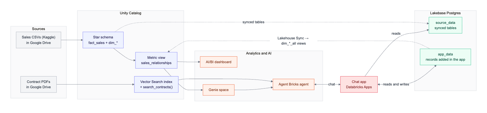

# Specifications: end-to-end marketing campaign analytics on Databricks

The blueprint of the demo: what it does, how each part is specified, and how to reuse it as a
reference for your own marketing analytics project. Run steps are in the README.

## 1. Purpose and scope

**Problem.** Zanlorensi Athletics, a fictional footwear and sports gear retailer, runs about 50
campaigns a year with agency partners. Its marketing team needs one place to answer:

- Which campaigns pay back their budget, and which segments, cities, stores and products respond?
- What do our agency contracts say about scope, fees, payment terms and termination?
- How do I add a new campaign or customer without waiting for the data team?

**Users.** Marketers (chat, data entry), analysts (dashboard, SQL), the data team (pipelines,
semantic layer, governance).

**Out of scope.** Attribution modeling, forecasting, and writing back to source systems. Data is
public (Kaggle) or fictional (four generated contracts) and anonymized: names are generated
pseudonyms and every e-mail uses the reserved `example.com` domain.

## 2. Architecture

| Layer | Capability | Folder |
| --- | --- | --- |
| Ingest | Lakeflow Connect (Google Drive) | `0_lakeflow-connect/` |
| Govern, model, analyze | Unity Catalog, metric view, AI/BI dashboard | `1_metric-views/` |
| Natural language | Genie space | `2_genie/` |
| GenAI | `ai_parse_document`, `ai_prep_search`, Vector Search, UC function, Agent Bricks | `3_agent-bricks/` |
| Application | Databricks Apps (Streamlit) | `4_apps/` |
| Operational data | Lakebase, synced tables, Lakehouse Sync | `5_lakebase/` |

**Principles.** (1) Define each KPI once, in the metric view, so the dashboard, Genie and the agent
can't disagree. (2) Every agent tool is a governed UC object. (3) The app writes to Postgres tables
it owns; Delta tables stay owned by ingestion. (4) Each app runs as its own service principal with
least privilege and no tokens in code. (5) Every notebook is idempotent and parameterized.

## 3. Data

Drive folder: `structured/` holds the 7 Kaggle CSVs, landed as one Delta table each.
`unstructured/` holds the contract PDFs, landed in the `contracts` volume plus a `contract_files`
mapping table.

| Table | Grain | Rows | Key |
| --- | --- | --- | --- |
| `fact_sales_normalized` | Sale (calendar 2024) | 1,000,000 | FKs to every dimension, `sales_date` |
| `dim_campaigns` | Campaign | 50 | `campaign_sk` |
| `dim_customers` | Customer | 100,000 | `customer_sk` |
| `dim_products` / `dim_stores` / `dim_salespersons` | Product / store / person | 210 / 500 / 2,000 | `*_sk` |
| `dim_dates` | Day | 366 | `date_sk`, `full_date` |

`schema_hints` pin key, date and amount types. `sales_date` is a timestamp, so it joins the date
dimension on `date(sales_date) = full_date`.

## 4. Semantic layer and Genie

**Metric view `sales_relationships`.** Star joins to every dimension, plus snowflake joins for
campaign start and end dates and for the store manager. Dimensions cover customer, store, product,
campaign, calendar and salesperson attributes. Measures:
- Sales statistics: `sales_sum`, `sales_avg`, median, quartiles, min, max, mode.
- Window measures: day over day, running total, `ytd_sales`, and trailing 7- and 30-day customers.

The business KPI is **sales per budget dollar** = `MEASURE(sales_sum) / campaign_budget`. The
notebook ships example queries for it. `CAMPAIGNS_TABLE` and `CUSTOMERS_TABLE` let stage 5 point
the view at `dim_*_all`, which adds the records created in the app.

**Dashboard.** One page on the metric view: sales by store, category, brand and top 10 salespeople.

**Genie.**
- **Source:** the metric view, with value dictionaries on the text columns.
- **Rules:** sales = `MEASURE(sales_sum)`; US dollars with 2 decimals; return on budget as above;
  "city" = customer residential location; top-N defaults to 10; no period means all of 2024 (say
  so); contract questions are out of scope.
- **Examples:** 8 verified example SQLs.
- **Stage 5:** adds the `dim_*_all` views.

## 5. Contracts and the agent

**Retrieval.** `ai_parse_document` → `ai_prep_search` chunks → `contract_chunks` (change data feed)
→ Delta Sync index with `databricks-gte-large-en` → UC function `search_contracts(query)`, which
returns the top 5 chunks and their file names.

**Agent** (Agent Bricks CLI, LangGraph):
- **Tools:** the Genie space and `search_contracts`, both bound with `auth = app`.
- **Routing:** data questions go to Genie and contract questions to `search_contracts`; mixed
  questions call both and combine the answers.
- **Guardrails:** cite the contract file, never invent figures or terms.
- **State:** managed sessions and memory, so the client sends only the new turn; MLflow tracing.

## 6. App and Lakebase

**Chat app** (Streamlit 1.44 on Databricks Apps):
- **Assistant:** chat with the agent.
- **Add data:** forms for a new campaign (2024 dates, budget > 0) and a new customer (unique
  e-mail), each above a searchable table of existing records that refreshes right after an insert.

**Lakebase.**
- `app_data.campaigns` and `app_data.customers` are app-owned, and Postgres checks keys, e-mails,
  dates and budget.
- `source_data.dim_*` are read-only SNAPSHOT synced tables from UC. Re-run them when the source
  changes.
- Lakehouse Sync streams `app_data` to UC history tables, and the `dim_*_all` views union them with
  the source.
- The app reads and writes only Postgres, so a new record shows up immediately.

## 7. Security

| Identity | Grants |
| --- | --- |
| Chat app SP | `CAN_USE` on the agent; `CAN_READ` on the dashboard its sidebar links to; Postgres `SELECT, INSERT` on `app_data` and column-level `SELECT` on `source_data` (business columns, not the connector's Drive metadata). No Unity Catalog grants |
| Agent SP | `USE CATALOG`, `USE SCHEMA`, `SELECT` on the schema, `EXECUTE` on `search_contracts`, `CAN_RUN` on Genie, `CAN_USE` on the warehouse and Vector Search endpoint, `CAN_QUERY` on the embedding model |

The grants live in `3_agent-bricks/4_GrantAgentAccess` and `5_lakebase/0_SetupLakebase`.

## 8. Using this as a reference

| If your project has... | Change | Keep |
| --- | --- | --- |
| Another source (Salesforce, GA4, SQL Server) | The connector in stage 0 | Table names and `schema_hints` |
| Another marketing model (channels, leads) | Metric view joins and measures | One metric view for all KPIs |
| Other KPIs (ROAS, CAC, conversion) | Measures, Genie rules, example SQL | Verify every example query first |
| Other documents (briefs, SOWs) | The `unstructured/` files | Parse → chunk → index → UC function |
| More tools (web search, CRM) | `agentbricks tools add` plus a grant | Routing in the prompt, `auth = app` |
| Other data entry (budgets, targets) | `app_data` tables and a form | Postgres plus Lakehouse Sync to UC |

**Checklist:**
1. Write the 5–10 business questions first; they become the Genie examples and benchmark.
2. Ingest with a managed connector and pin the types.
3. Build one metric view, then the dashboard and Genie on top of it.
4. Benchmark Genie against ground-truth SQL.
5. Expose retrieval as a UC function.
6. Give each app least-privilege grants.
7. Keep operational writes in Lakebase and sync them back.
